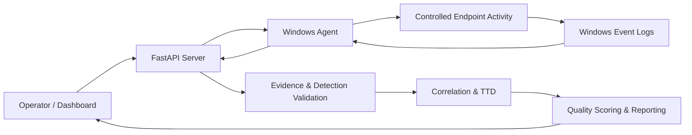

# CyberBag

**Purple Team Validation Framework for Windows Telemetry, Detection Engineering, and Evidence-Based Defensive Measurement**

    

> **Portfolio and research documentation only.** CyberBag's implementation source code is maintained privately. This repository describes the architecture, methodology, and project direction; it is not a downloadable or runnable distribution.

## Overview

CyberBag is a purple team validation framework designed to examine whether controlled, MITRE ATT&CK-mapped behavior on Windows endpoints generates the expected telemetry and meaningful detection evidence. Its focus is the *quality of defensive validation*, rather than exploitation or replacing a SIEM.

The core question is: **Did the environment observe the behavior, detect it with relevant evidence, correlate the activity, and do so in a useful timeframe?**

## Goals

- Connect controlled adversary-emulation exercises to defender-side evidence.
- Evaluate Windows event visibility and rule-based detection outcomes.
- Measure Time-to-Detect (TTD) where timestamps and evidence support it.
- Explain detection quality through transparent scoring dimensions.
- Help identify gaps in telemetry configuration and detection engineering.

## Technology and Scope

| Area | Documented design |
| --- | --- |
| Endpoint | Windows agent for controlled task execution and telemetry collection |
| Telemetry | Windows Security, Sysmon Operational, and PowerShell Operational logs |
| Backend | Python / FastAPI |
| Validation | ATT&CK mapping, evidence evaluation, detection verdicts, correlation |
| Measurement | Time-to-Detect and evidence-based scoring |
| Interface | Operator dashboard |

*These capabilities are described in the project documentation; independent testing and performance benchmarks are not included in this public portfolio.*

## High-Level Architecture

The server coordinates scenarios, evidence evaluation, scoring, and reporting. The Windows agent handles endpoint-side controlled execution and collection of relevant event records.

## Detection Validation Workflow

1. Select a controlled, ATT&CK-aligned scenario.
2. Run it on an authorized Windows test endpoint.
3. Collect telemetry in a bounded execution window.
4. Normalize and inspect relevant evidence.
5. Evaluate rule matches and correlate related activity.
6. Report detection verdicts, TTD, and scoring dimensions.

The documented verdict categories include **Detected**, **Partially detected**, **Visible but undetected**, **Not visible**, and **Inconclusive**. The presence of an event alone is not treated as proof of detection.

## Scoring Methodology

The documented model evaluates four dimensions:

| Dimension | What it considers |
| --- | --- |
| Coverage | Whether expected telemetry is observed |
| Fidelity | How specifically evidence supports the behavior |
| Timeliness | Whether detection happens within a useful window |
| Actionability | Whether evidence provides sufficient investigative context |

The research design uses AHP-derived weights and a weighted geometric mean:

\[Q = C^{w_C} \times F^{w_F} \times T^{w_T} \times A^{w_A}\]

This formula summarizes the documented methodology; it is not a claim of independently validated effectiveness or a published benchmark.

## Dashboard and Evidence Gallery

**Real screenshots are being prepared.** The following items are planned for this portfolio; no synthetic screenshots are presented as evidence.

| Planned capture | What it will demonstrate |
| --- | --- |
| Dashboard overview | Operator interface and summary metrics |
| Scenario execution | Controlled workflow and task status |
| Detection evidence | Observed events and validation verdicts |
| Scoring breakdown | Quality dimensions and supporting explanations |

## Research Context

CyberBag draws on MITRE ATT&CK mapping, purple team validation, Windows telemetry, detection engineering, and explainable defensive measurement. It is conceptually related to adversary emulation and BAS workflows, but its documented emphasis is on evidence-backed validation and scoring.

## Current Status and Limitations

- **Research / active development:** this is not represented as a stable production release.
- Source code, agent deployment, and server installation are **not publicly available** in this repository.
- Dashboard screenshots, measured results, and independent benchmarks should be added only after they are captured and verified.
- Telemetry and verdict quality depend on endpoint logging configuration, scenario design, and evidence availability.

## Responsible Use

CyberBag is intended only for authorized defensive validation, controlled lab research, and purple team exercises. Do not run validation activities on systems without explicit permission.

## Source Availability and Rights

This public repository is a **project portfolio**, not an open-source software release. The implementation is maintained in a separate private repository. No permission to use, redistribute, or modify private implementation code is granted by this portfolio. Documentation rights are reserved unless separately licensed.

## Contact

For project inquiries or technical discussion, use the GitHub profile associated with this repository.
